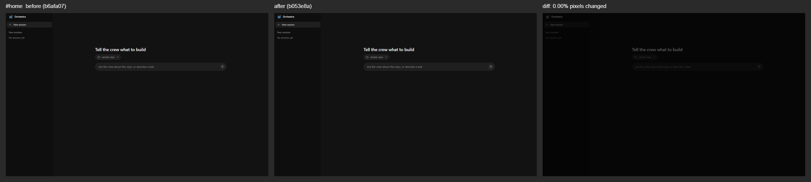
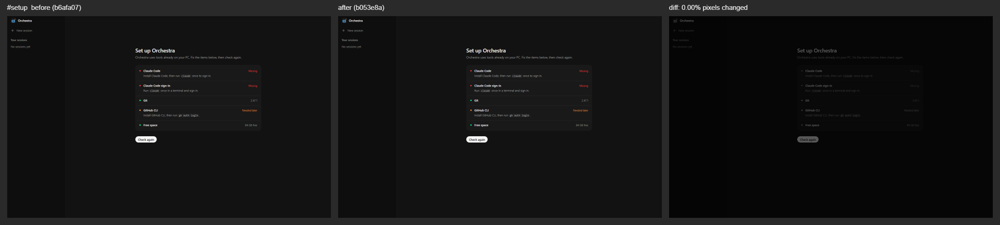
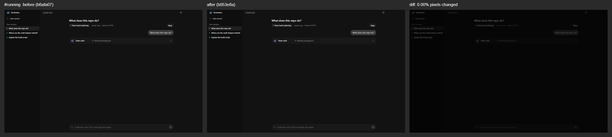
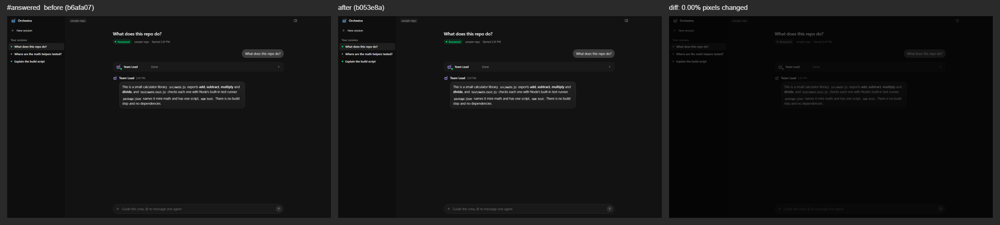
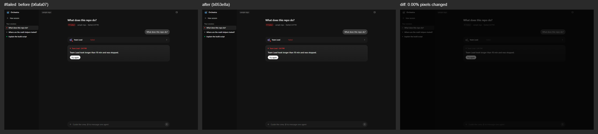
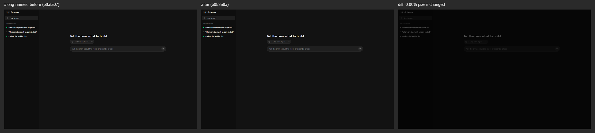
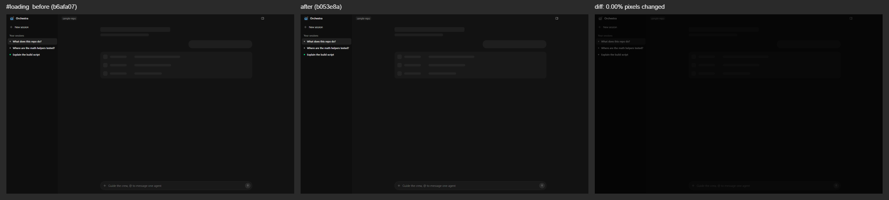
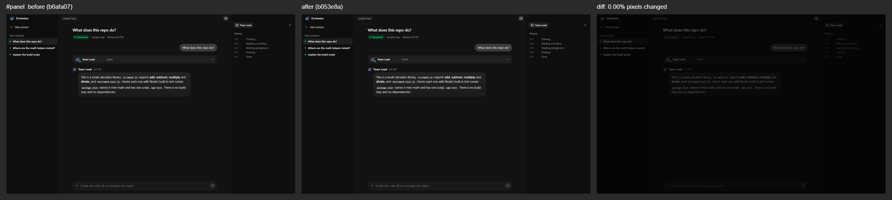

<!-- orchestra-evidence -->
## Evidence for `b053e8a`

Head `b053e8a` vs base `b6afa07` · [CI run](https://github.com/vikas53953/orchestra/actions/runs/45056900563) · PR #13 · [all files](https://github.com/vikas53953/orchestra/tree/evidence/evidence/13/b053e8a)

CONFIRMED = proven in this CI run · REPORTED = claimed with a link, not re-run here · UNVERIFIED = not proven yet

| check | result | label | note |
|---|---|---|---|
| typecheck | pass | CONFIRMED |  |
| tokens | pass | CONFIRMED |  |
| unit | pass | CONFIRMED |  |
| red-proof | not run | UNVERIFIED | not applicable: this PR does not change both unit tests and app source |
| mutation | pass | CONFIRMED |  |
| build | pass | CONFIRMED |  |
| e2e | pass | CONFIRMED | recorded replies only \(pre-check\) |
| installer | pass | CONFIRMED |  |
| evidence | pass | CONFIRMED |  |
| real-ai | not run | UNVERIFIED | UNVERIFIED until run on owner's PC \(D9\) |

### Numbers (measured on the runner, base → head)

| metric | base → head |
|---|---|
| renderer bundle (gzip) | 57 KB → 57 KB (no change) |
| unit tests duration | 26574 ms → 26631 ms (+57 ms, +0.2%) |
| cold start to first screen, Home or Setup (median of 3) | 405 ms → 375 ms (−30 ms, −7.4%) |

### Before / after (1440×900, reduced motion)

Each picture: before | after | changed pixels in magenta.

**#home** — 0.00% pixels changed

**#setup** — 0.00% pixels changed

**#running** — 0.00% pixels changed

**#answered** — 0.00% pixels changed

**#failed** — 0.00% pixels changed

**#long-names** — 0.00% pixels changed

**#loading** — 0.00% pixels changed

**#panel** — 0.00% pixels changed

