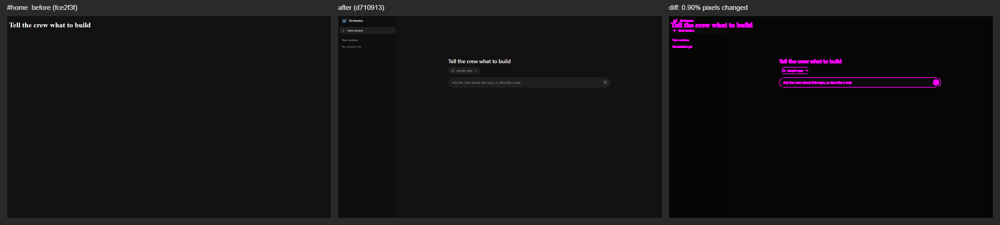
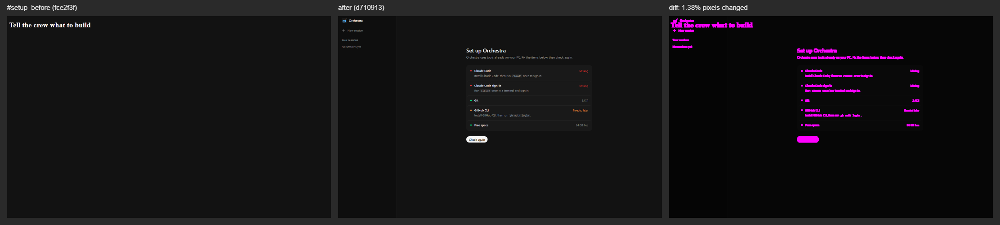
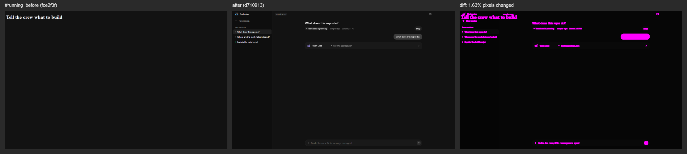
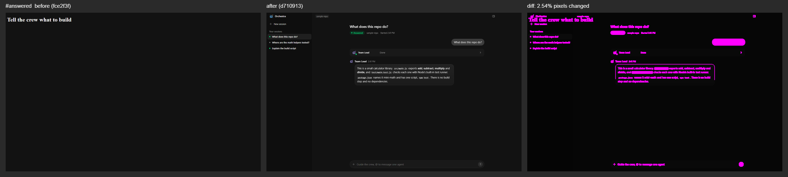
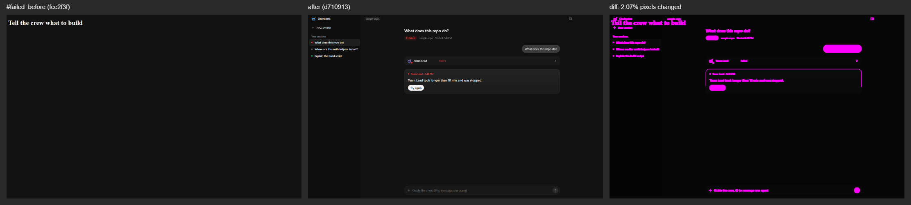
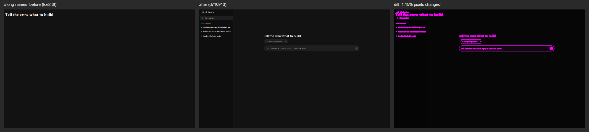
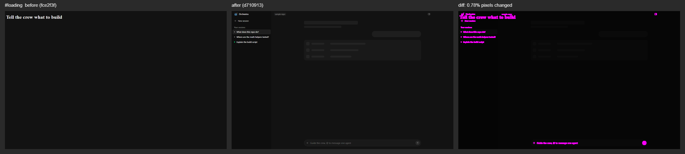
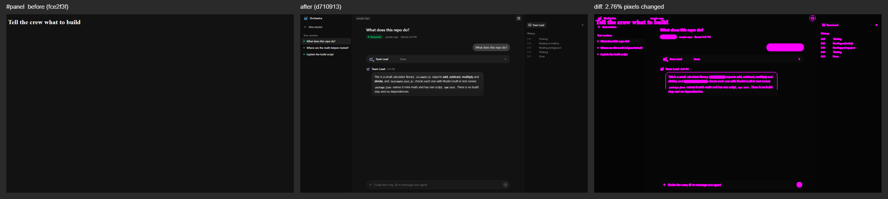

<!-- orchestra-evidence -->
## Evidence for `d710913`

Head `d710913` vs base `fce2f3f` · [CI run](https://github.com/vikas53953/orchestra/actions/runs/45061064448) · PR #9 · [all files](https://github.com/vikas53953/orchestra/tree/evidence/evidence/9/d710913)

CONFIRMED = proven in this CI run · REPORTED = claimed with a link, not re-run here · UNVERIFIED = not proven yet

| check | result | label | note |
|---|---|---|---|
| typecheck | pass | CONFIRMED |  |
| tokens | pass | CONFIRMED |  |
| unit | pass | CONFIRMED |  |
| red-proof | pass | CONFIRMED |  |
| mutation | pass | CONFIRMED |  |
| build | pass | CONFIRMED |  |
| e2e | pass | CONFIRMED | recorded replies only \(pre-check\) |
| installer | pass | CONFIRMED |  |
| evidence | pass | CONFIRMED |  |
| real-ai | not run | UNVERIFIED | UNVERIFIED until run on owner's PC \(D9\) |

### Numbers (measured on the runner, base → head)

| metric | base → head |
|---|---|
| renderer bundle (gzip) | 46 KB → 57 KB (+11 KB, +23.4%) |
| unit tests duration | 324 ms → 25881 ms (+25557 ms, +7888.0%) |
| cold start to first screen, Home or Setup (median of 3) | n/a at base → 315 ms |

- unit tests were red at base; time still measured

- cold start n/a at base: no Home or Setup screen became visible — run 1: page.waitForSelector: Timeout 30000ms exceeded.

### Before / after (1440×900, reduced motion)

Each picture: before | after | changed pixels in magenta.

**#home** — 0.90% pixels changed

**#setup** — 1.38% pixels changed

**#running** — 1.63% pixels changed

**#answered** — 2.54% pixels changed

**#failed** — 2.07% pixels changed

**#long-names** — 1.15% pixels changed

**#loading** — 0.78% pixels changed

**#panel** — 2.76% pixels changed

